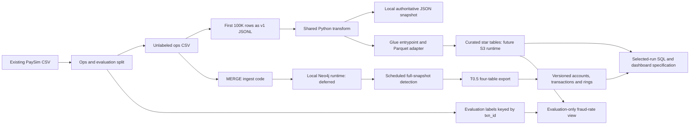

# PaySim migration: delivered repo architecture

This delivery implements and fixture-tests the **batch-first code path** toward
the hybrid architecture in [PLAN.md](../PLAN.md). PLAN.md remains unchanged as
the broader target. The user requested a repository, not deployed services.
No Neo4j, AWS stack, live Athena views, scheduler or BI dashboard was deployed
for this delivery. Terraform validation and local tests do not imply deployment.

## Built components and data flow

This diagram describes code interfaces and future runtime wiring, **not a live
system**. Tests substitute readers/sinks for graph, Spark and cloud components.

- **Identity and labels:** `contracts/transaction_event.py` defines v1 events,
  null merchant balances and txn_id from canonical payload + original CSV
  basename + original 1-based row number. `download_data.py` has pure split/write
  helpers and an optional Kaggle-downloading main. Operational data rejects
  labels; the evaluation sidecar is joined only for ground-truth reporting.
- **Batch convergence:** `pipeline/` uses the contract for bounded sampling,
  normalization, exact Decimal casts, fixed type keys and deduplication.
  Local and Glue entrypoints call the same transform. Inputs form a complete
  authoritative snapshot, not an incremental delta. Glue output uses a content
  hash prefix and catalog pointers to one snapshot. Replays do not append facts;
  failed multi-table replacements require rerun/reconciliation before reporting.
- **Graph path:** `database_creation_script.py` MERGEs Account nodes and
  TRANSACTION relationships keyed by txn_id. `detection/required_signals.cypher`
  contains ordered required-signal queries; GDS stays a scheduled/windowed batch,
  never a per-event call. The Python fixture approximation does not prove GDS
  Louvain behavior. `batching_python_driver.py` reads with txn_id keyset
  pagination and writes the four-table baseline to a new local directory.
- **Versioned outputs:** `detection/exports.py` reuses T0.5 normalization, writes
  immutable run-specific JSONL and a completion manifest, and performs explicit
  selected-run left joins. Every signal identifies detection completion time and
  inclusive step scope. Community IDs/rings are meaningful only within a run.
  Scope/completion metadata must truthfully describe the actual detection run;
  the exporter cannot prove its prior history.
- **Reporting:** `reporting/sql/` defines 16 views for selection, details,
  required visuals and quality checks. `reporting/registry.py` prepares flat
  complete-run records from verified manifests. Latest selection can be pinned
  to a chosen run for repeatable refreshes. Model flags and evaluation rates are
  independent. `DASHBOARD_SPEC.md` describes Power BI Import or other BI tools;
  the threshold of 30 is explicitly provisional.
- **Infrastructure design:** `infra/` defines raw/curated encryption and public
  blocks, Glue catalog/job/role/logging, a monthly budget and an enforced-scan
  Athena workgroup. The expected combined design is 21 resources; no plan/apply
  or live inventory establishes that expectation as deployed. The S3 backend
  settings require an existing separately managed state bucket and native lock
  files. Credentials are supplied outside source; the example lists names only.

The star-schema grain/types are documented in [STAR_SCHEMA.md](STAR_SCHEMA.md).
Graph windows/layout and reporting semantics are in
[detection/EXPORTS.md](../detection/EXPORTS.md) and
[reporting/DASHBOARD_SPEC.md](../reporting/DASHBOARD_SPEC.md).

## Mapping to the unchanged target plan

| PLAN step | Delivered code | Deferred or substituted |
|---|---|---|
| 1. Event/data contracts | Versioned ops events, stable identity, eval separation, merchant nulls, replay tests | Deployed producer/consumer enforcement |
| 2. AWS foundation | Terraform definitions, env names, budget, encryption, scoped Glue role, hosting decision and teardown runbook | Plan/apply, external state bucket bootstrap, live IAM/network/secrets integration; Neo4j remains local |
| 3. Streaming | Shared contract/transform reusable by a future stream path | Kinesis, Lambda, stream raw landing, graph consumer, latency/retry validation; no streaming implementation is claimed |
| 4. Glue batch/curation | Reproducible sample, shared transform, Glue entrypoint/definition, four-table model and reconciliation code | Real S3/Glue/Parquet execution, catalog validation, batch/stream equivalence |
| 5. Graph to reporting | Required detection code, baseline exporter, versioned account/transaction/ring snapshots and joins | Live GDS, actual completed-window provenance, graph export uploads and scheduling |
| 6. Redshift/Power BI | Athena SQL design and tool-independent Import dashboard specification | Athena replaces Redshift for the first prototype; no native query or BI artifact deployed; Redshift remains stretch S2 |
| 7. Verify/teardown | Fixture suite, explicit verification checklist, architecture/readme/runbook | Live end-to-end acceptance, cost measurements and deployed-resource teardown |

The thin-slice decisions in IMPLEMENTATION_PLAN.md defer streaming (stretch S1)
and Redshift (S2), use a reproducible ~100K-row sample instead of 6.3M rows, and
keep graph hosting local. This limits prototype cost and scope; it does not
rewrite PLAN.md's hybrid target. Aura is evaluated conditionally in the hosting
note, but nothing is hosted there. Power BI was unavailable, so T4 delivers a
portable specification rather than screenshots or a .pbix.

## Evidence, limitations and path to live operation

See [VERIFICATION_CHECKLIST.md](VERIFICATION_CHECKLIST.md) for task-level proof
and pending checks. SQLite execution checks SQLite behavior, **not native
Athena Trino/Presto syntax/functions or Hive DDL**. Mocked graph/Parquet results
do not validate a database server, Spark runtime or cloud service. No actual
fraud findings, calibrated threshold or account-wide cost claim follows from
the controlled fixtures.

To make the code live, complete the checklist's gates in order: configure a
compatible local Neo4j/GDS and unlabeled sample; approve/load/replay/detect and
generate a real baseline; finish the T1 plan with confirmed inputs/state;
approve deployment and verify budget delivery; publish artifacts and execute
the bounded Glue job with replay/reconciliation; publish a completed graph run;
validate native Athena DDL/views/decimals and quality gates; then build and test
the BI refresh against a pinned run. Review input immutability, quiescent graph
reads and non-atomic overwrite/catalog failure recovery before relying on them.

Keep evaluation data in a separately scoped location or narrow IAM before any
upload. The existing raw-bucket role's broad project read is not an evaluation
access boundary. Validate runtime logging/dependencies/network access, include
artifact/query-result retention in the cost review, and measure costs rather
than treating scan limits or budget alerts as hard spend caps. Streaming and
Redshift require a separate decision, implementation and explicit cost approval.

Teardown after any future deployment is covered by [TEARDOWN.md](TEARDOWN.md).
